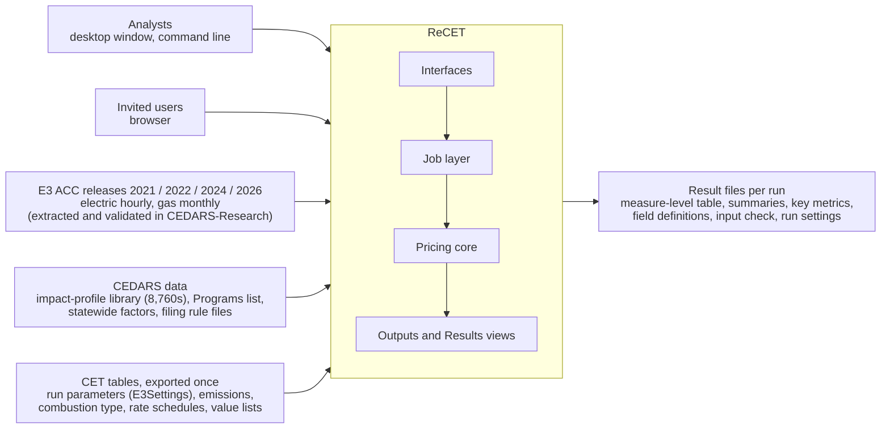
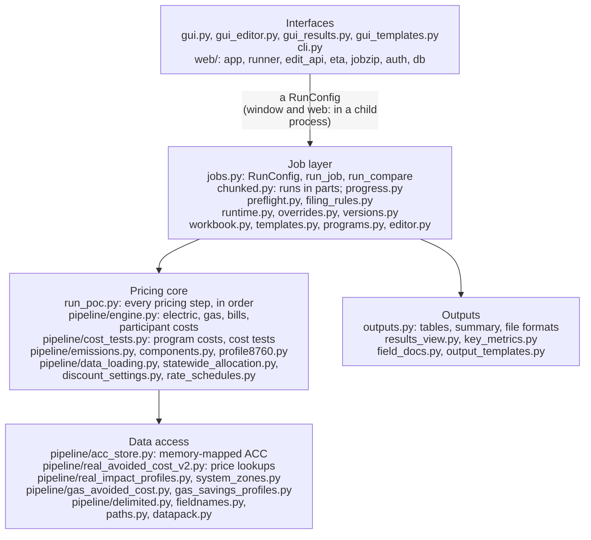
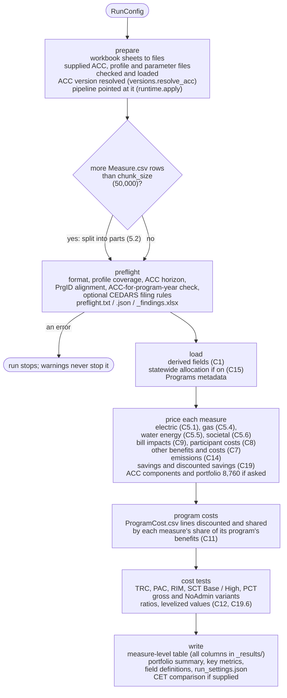
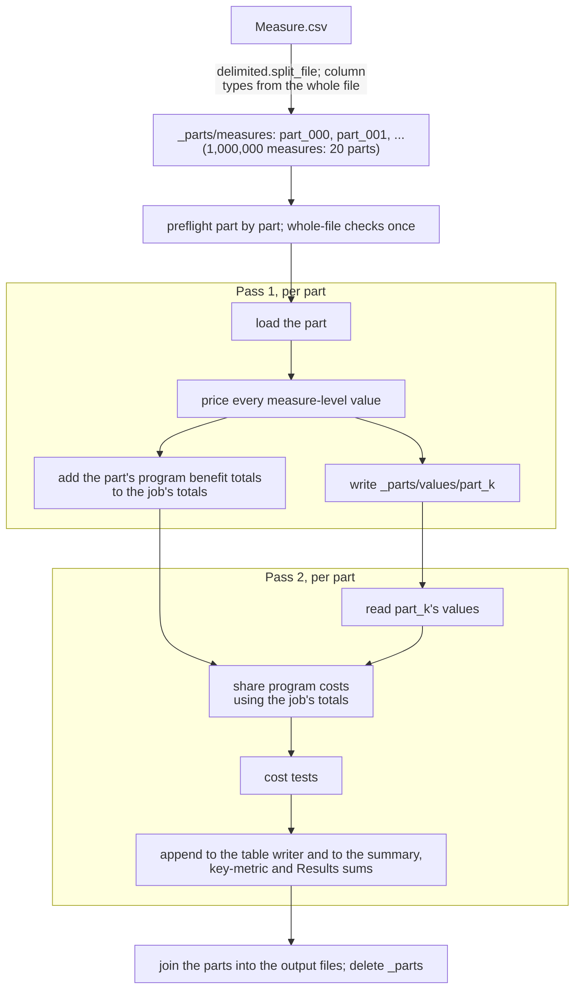
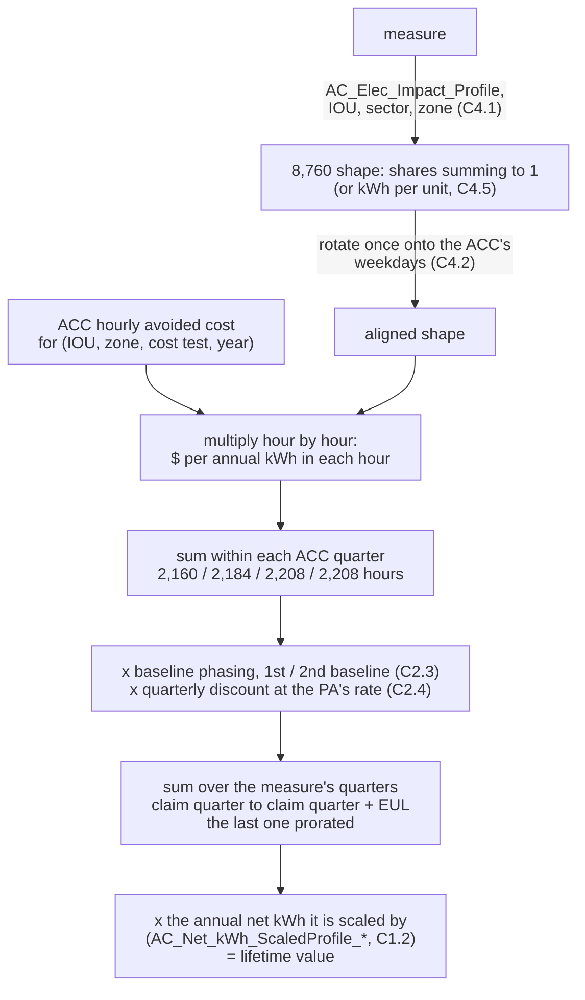
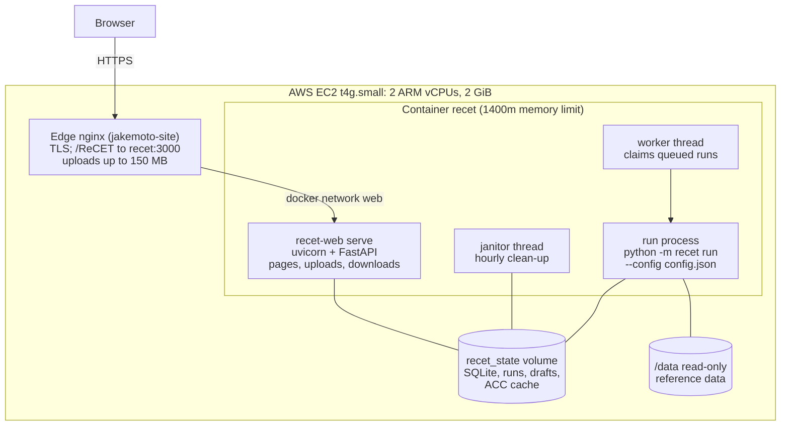
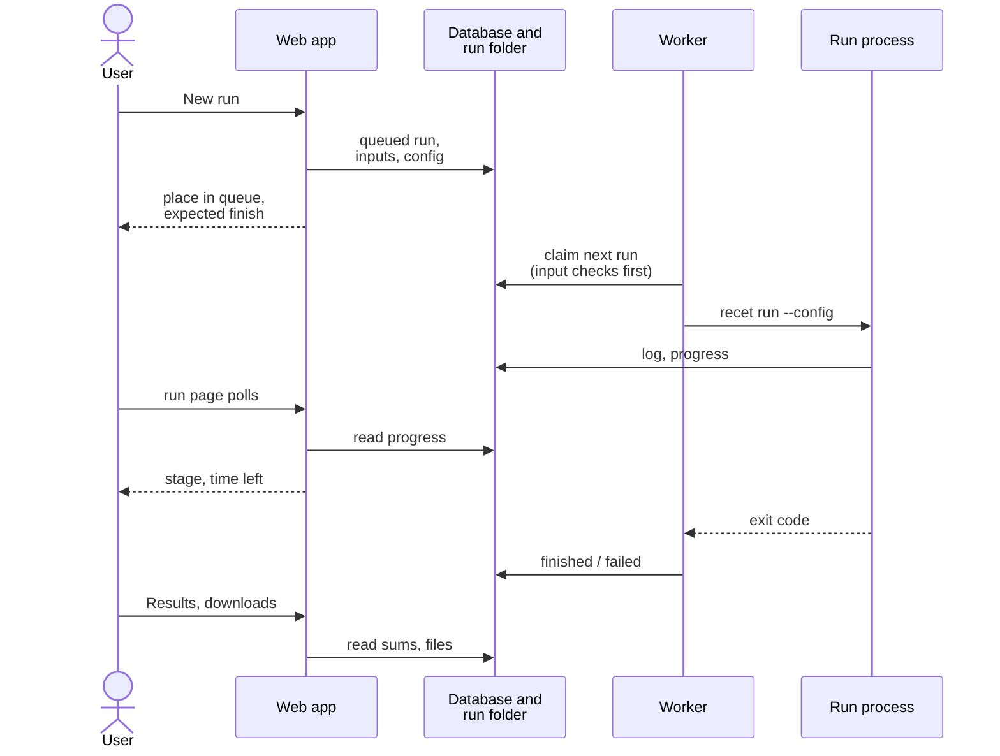

# System architecture

How ReCET is built: what it has to do (section 1), the pieces it is made of and how they fit together (sections 2-4), how a run flows through them
(section 5), how the pricing core is laid out (section 6), where its data lives (section 7), the web app and its deployment (section 8), how it stays
fast and small (section 9), how it is kept correct (section 10), and what it does not yet do (section 11).

This document describes the system. The formulas are in [Calculations](CALCULATIONS.md) and [Output fields](OUTPUT_FIELDS.md), the inputs in
[Input fields](INPUT_FIELDS.md) and [Input formats](INPUT_FORMATS.md), and the controls in the [web guide](WEB_GUIDE.md) and the
[desktop and command-line guide](USER_GUIDE.md). Requirement IDs (BR-06.5 and so on) are those of the CEDARS Replacement BRD.

## 1. Purpose, scope and requirements

### 1.1 What ReCET is

ReCET ("reset") is the rebuilt CEDARS Cost Effectiveness Tool. It takes the CET's own inputs (a `Measure.csv` and an optional `ProgramCost.csv`, or one
Excel job workbook), prices every measure **hour by hour** on an Avoided Cost Calculator (ACC) release, and writes every CET measure-level output column
plus summaries. It is a working prototype of the calculation core of a CEDARS replacement (BRD BR-06), offered three ways over one engine:

| Interface | Entry point | Who it is for |
|---|---|---|
| Desktop window | `python -m recet`, `recet-gui` (`gui.py`) | an analyst on their own computer, with the reference data on a local or network drive |
| Command line and Python | `recet run ...` (`cli.py`), `recet.jobs.run_job` | scripted and batch runs, research scripts, tests |
| Web app | `recet-web serve` (`web/`), jakemoto.com/ReCET | invited users with a browser and nothing installed |

### 1.2 Scope

In scope: pricing (benefits, supply costs, participant costs, bill impacts, program costs, every cost test and ratio, emissions, savings and levelized
values), input checking (format, pricing coverage, CEDARS' own filing rules, the ACC-for-program-year check), statewide allocation, supplied profiles and
ACC files, comparisons between ACC versions, and the results views.

Out of scope, by design: the CEDARS claims and budget-filing workflow (confirmation, reopening, Kiteworks PII handling), the Programs, Monthly Reports
and Documents modules, and an integration API. ReCET reads the CEDARS Programs list and CEDARS' published rule files as data; it does not talk to
CEDARS.

### 1.3 Functional requirements and how they are met

| Requirement | What it asks | How ReCET meets it | Status |
|---|---|---|---|
| CET parity | the CET's inputs in, the CET's outputs out | the 74 `Measure.csv` columns and `ProgramCost.csv` read as CET writes them (pipe-delimited; comma and tab also accepted); every CET measure-level output column written except `JobID` and `PA` | met; the deliberate differences are listed in C17 |
| Hourly valuation, load shifting (BR-06.6) | value savings in the hour they occur; a measure that only moves load has value | each measure's 8,760 profile is multiplied by that hour's avoided cost **before** summing (C5.1); kWh-per-unit profiles (C4.5) | met |
| ACC per measure (BR-06.5) | price records on the ACC that applies to them; flag the ones that are not | optional `ACCVersion` column (C3.5); the "Priced for" check flags records whose ACC does not normally apply to their program year (`versions.expected_accs`) | met |
| Version labels (BR-11.7) | name each ACC release unambiguously | versions keyed and shown by ACC year ("2026 ACC"); CET's Avoided Cost Version numbers mapped on read (`versions.py`) | met |
| Participant Cost Test (BR-06.8) | the SPM's fourth test, which the CET lacks; cost tests and value streams as configuration | `run_poc.participant_cost_test`; every test is code in `pipeline/cost_tests.py` | partly met: the PCT is added, but tests and value streams are not configuration (needs D14) |
| Filing checks (BR-06.3, BR-03.6, BR-03.3) | check a job against CEDARS' upload rules before upload | CEDARS' published claims and budget-filing rule files, shipped unchanged and versioned by effective date (`filing_rules.py`); failing records flagged, never blocked; the rule set used recorded in `run_settings.json` | met; multi-file batch upload dropped for ReCET |
| Output templates and key metrics (BR-06.10) | choose and order output columns; headline results with definitions and drivers | `output_templates.py`, `key_metrics.py`, `field_definitions` written by every run (`field_docs.py`) | met |
| Program costs need not line up (BR-06.16) | calculate measures whose program has no program-cost record | a measure with no `ProgramCost.csv` row is priced with no program costs, and a row with no measures is charged to none; preflight warns about both (`preflight._program_alignment`; C17 item 11) | met |
| Minimal input set (BR-06.15) | an exploratory run needs only the fields that change a result | descriptive columns may be left out (`templates.with_defaults`); a missing calculation column is still an error | met, except lifecycle savings as input (not built, by decision) |
| Run status (BR-06.2) | queue position, progress, estimated completion; notification; isolation | queue position, progress bar, time left and queue estimates (`progress.py`, `web/eta.py`); an email to the owner when a run finishes or fails (`web/notify.py`); each run in its own process | partly met: scaling and isolation are not built (section 11) |
| Compare and share runs (BR-06.11) | compare any two runs; share a run with another user | the web Compare page and CSV (`results_view.compare`: each run's value, the difference and the % change at the portfolio, program year, segment, sector or program level); a run shared read-only by email (`run_shares`) | met for the web app; the desktop window still compares two ACCs of one job only |
| Statewide allocation (BR-06.7) | split a statewide program across the IOUs; the allocated totals reconcile to the unallocated ones | `pipeline/statewide_allocation.py` with the CEDARS allocation factors (C15); `statewide_reconciliation` table (`statewide_allocation.reconciliation`) | met; factors come from a file, not a Programs module |
| Data dictionary (BR-08.1) | every field with its definition, source and version, cost-test treatment, time basis, aggregation, rounding and years in use | INPUT_FIELDS.md and OUTPUT_FIELDS.md (definitions, units, formulas); every run's `field_definitions` table adds the attributes per column (`field_attributes.py`, rules on the name and the documented unit, checked against the cost tests by `tests/test_field_attributes.py`) | met for the measure-level file; the attributes are rules, not a maintained registry |
| Supplied data | users' own profiles, ACC files, run parameters, factors, program metadata | `overrides.py`: a supplied key replaces the built-in one, a new key extends it; every kind has a template and a check | met |
| Transparency | every output traceable to its inputs | every output column documented with its full formula and a worked number; `ProfileSource` and `*PricingStatus` columns say how each fuel was priced; `run_settings.json` records everything needed to reproduce a run | met |

### 1.4 Nonfunctional requirements

| Requirement | Target | Achieved | Where it comes from |
|---|---|---|---|
| Throughput (BRD NFR Performance) | 1,000,000 records on 8,760 profiles in 15 minutes or less | 7.4 minutes on the web server (0.1.50, zipped CSV, no filing checks); under 5 minutes on a 16-thread laptop | runs in parts (section 9), per-route pricing |
| Memory | a 1,000,000-record run inside the server's 1.4 GB container | peak 1.01 GiB on the server; about 1 GB committed on the laptop | parts, memory-mapped ACC, one BLAS thread |
| Accuracy | reproduce the CET where the CET is right | on four real CET runs (21,370 measures): gas benefit, participant costs, bill impacts and savings equal to 1.0000; TSB 1.0013 of CET's without the TOU end uses, whose CET T&D is a known CET error | C17 |
| Reproducibility | a run can be repeated exactly | `run_settings.json` (every setting, file and version), inputs kept with the run, deterministic arithmetic, no sampling | `jobs.write_settings` |
| Auditability | every number explained | documents checked by tests against the code (section 10) | `recet/docs`, `tests/` |
| Security (web) | invitation-only, no account takeover, no cross-user access | argon2 passwords, hashed session and setup tokens, CSRF on every form, login rate limits, per-user run ownership, safe zip extraction (section 8.4) | `web/auth.py`, `web/jobzip.py` |
| Accessibility (web) | WCAG 2.2 Level AA on every web page | the 2026-10-29 audit's gaps fixed in 0.1.67-0.1.68 (axe clean, keyboard checked) and NVDA's in 0.1.70 (`tests/screenreader`); column resizing is drag-only (section 8.7) | Jake, 2026-10-29 |
| Portability | Windows, macOS, Linux; x86 and ARM | pure Python (numpy, pandas, pyarrow); the web image builds for arm64 and amd64 | `pyproject.toml`, `Dockerfile` |
| Data hygiene | large files never in git; nothing derived is the only copy | reference data folder with a checksummed manifest; caches rebuildable and deletable | `paths.py`, `datapack.py` |

## 2. System context



Every outside source enters as a file, read at run time. Nothing is fetched from CEDARS, eTRM or E3 while a run is going: the research repository
(CEDARS-Research) extracts and validates the ACC releases, and the CEDARS files are downloaded once and shipped or placed in the reference data folder.

## 3. Layers



Two rules hold across the layers:

* **No UI code below the interfaces.** `editor.py` and `results_view.py` hold the logic of the Edit inputs and Results tabs with no tkinter, so the web
  app reuses them and the tests exercise them.
* **One run path.** The window, the command line and the web app all end in `jobs.run_job` (or `run_compare`) with a `RunConfig`. The window and the web
  app start it as `python -m recet run --config config.json` in a separate process, so a run's memory and caches are its own, the interface stays
  responsive, and Stop kills the process.

## 4. Module map

Every module in the package. Paths are relative to `recet/`.

| Module | Layer | Responsibility |
|---|---|---|
| `gui.py` | interface | the desktop window: Job, Edit inputs, Supplied inputs, Options, Reference data, Log and Results tabs; runs jobs in a child process |
| `gui_editor.py` | interface | the window's Edit inputs tab (layout and events over `editor.py`) |
| `gui_results.py` | interface | the window's Results tab (layout and events over `results_view.py`) |
| `gui_templates.py` | interface | the window's output-template editor: two-list field picker and the default template (over `output_templates.py`) |
| `cli.py` | interface | `recet run`, `preflight`, `template`, `check`, `data`, `openbca`, `cet-version` |
| `web/app.py` | interface | the FastAPI pages and JSON endpoints under `/ReCET` |
| `web/edit_api.py` | interface | the web Edit inputs page: drafts, saves, Validate inputs |
| `web/runner.py` | interface | the run queue: worker threads, child processes, Stop, retention clean-up |
| `web/eta.py` | interface | when a queued run should start and finish |
| `web/notify.py` | interface | the email to a run's owner when it finishes or fails (SMTP) |
| `web/jobzip.py` | interface | the job upload: one zip with `Measure.csv` and an optional `ProgramCost.csv`, extracted safely |
| `web/auth.py` | interface | passwords, sessions, setup links, CSRF tokens, login rate limits |
| `web/db.py` | interface | the SQLite store |
| `web/config.py` | interface | the web app's settings from `RECET_WEB_*` environment variables |
| `web/value_lists.py` | interface | the Docs > Value lists pages and admins' changes to the dropdown lists |
| `web/cli.py` | interface | `recet-web serve`, `create-admin`, `reset-link`, `users`, `warm-cache` |
| `jobs.py` | job | `RunConfig`, `run_job`, `run_compare`; the run folder and its files |
| `chunked.py` | job | a large job run in parts, in two passes |
| `progress.py` | job | stage and time-left reports for the progress bar |
| `preflight.py` | job | the input check before any pricing |
| `filing_rules.py` | job | CEDARS' claims and budget-filing rules as a versioned rule library |
| `runtime.py` | job | points the pipeline at a run's ACC and supplied files; clears caches between runs |
| `overrides.py` | job | loading and checking supplied files (profiles, ACC files, run parameters, factors) |
| `versions.py` | job | the ACC versions, their files, labels, and which ACC applies to which filing |
| `workbook.py` | job | a job as one Excel workbook |
| `templates.py` | job | templates for every input; the CET header; the minimal input set |
| `programs.py` | job | the CEDARS Programs list and the `Prg_*` columns |
| `editor.py` | job | small-job table editing: loading, dropdown values, cell checks, saving |
| `run_poc.py` | pricing | job-level orchestration of every pricing step and the cost tests (the module keeps its proof-of-concept name) |
| `components.py` | pricing | each ACC component priced on its own (`ElecValue_*`, `GasValue_*`) |
| `profile8760.py` | pricing | the portfolio's combined 8,760-hour savings profile |
| `pipeline/engine.py` | pricing | the pricing engine: grouped versions and their per-measure references |
| `pipeline/cost_tests.py` | pricing | program-cost weighting, cost tests, gross and NoAdmin variants, levelized values |
| `pipeline/emissions.py` | pricing | CO2, NOx and PM10, ported from CET's CalcEmissions |
| `pipeline/data_loading.py` | pricing | reading `Measure.csv` and deriving the pricing fields (C1) |
| `pipeline/statewide_allocation.py` | pricing | splitting statewide programs across the IOUs |
| `pipeline/discount_settings.py` | pricing | discount rates and base year per PA and ACC version |
| `pipeline/rate_schedules.py` | pricing | retail rates for the bill impacts (RIM) |
| `pipeline/acc_store.py` | data | the electric ACC as memory-mapped `(blocks, 8760)` arrays cached on disk |
| `pipeline/real_avoided_cost_v2.py` | data | hourly price lookups by IOU, zone, cost test and year, including SCG routing |
| `pipeline/real_impact_profiles.py` | data | the CEDARS impact-profile library: matching, shapes, calendar alignment |
| `pipeline/system_zones.py` | data | the climate zone a `System` measure is priced in |
| `pipeline/gas_avoided_cost.py` | data | the monthly gas ACC, by component |
| `pipeline/gas_savings_profiles.py` | data | the monthly gas profiles |
| `pipeline/delimited.py` | data | reading CET-format files; splitting a large file into parts |
| `fieldnames.py` | data | ReCET's field names and CET's legacy names, both ways |
| `paths.py` | data | where package data, the reference data folder and the cache are |
| `datapack.py` | data | building, verifying, packing and unpacking the reference data folder |
| `jobspec.py` | job | the job spec: the versioned JSON a caller hands the worker (inputs by URI, settings, engine release, pinned reference files, allocation version) and its checks |
| `worker.py` | job | `recet worker run`: one job from a job spec, its outputs and `receipt.json` sent to the spec's outputs URI |
| `storage.py` | data | where a worker's files come from and go to: local paths, file:// and s3:// (boto3 only when S3 is used) |
| `openbca/run.py` | job | OpenBCA's own engine on its workbooks: finds a pinned checkout, stages a copy in the run folder, runs `openbca/engine.py`, writes OpenBCA's output tables; comparison C1 |
| `openbca/engine.py` | job | runs inside OpenBCA's interpreter (never imported by ReCET): the SQLmesh plan, the output export, the table-by-table comparison |
| `openbca/ca_config.py` | job | California's jurisdiction tables for OpenBCA from an ACC file (hourly electric avoided cost per IOU and climate zone, TRC / PAC cost treatment); comparison C2 |
| `openbca/workbook.py` | job | writes an OpenBCA Program Input workbook in OpenBCA's template layout |
| `openbca/translate.py` | job | a CET job as an OpenBCA job priced on ReCET's own electric and gas shapes, avoided costs and discount rates, with every known difference flagged; `compare_job` runs both tools and compares them (C3 / C4) |
| `cet_versions/releases.py` | pricing | replica: the prior CET releases ReCET reproduces (21.0 to 25.1) and the switches that say how each one calculates |
| `cet_versions/tables.py` | data | a release's quarterly tables: a folder of CSVs (the test fixtures) or the shipped small tables plus the parquet export |
| `cet_versions/inputs.py` | pricing | replica: CET's input views (InputMeasurevw, InputProgramvw, Settingsvw) as each release generates them |
| `cet_versions/calc_ce.py` | pricing | replica: CalcCE of 22.1 to 25.1: benefits, supply costs, the cost tests' costs, bills, ratios |
| `cet_versions/calc_ce_2021.py` | pricing | replica: CalcCE of 21.0 (a different procedure) |
| `cet_versions/calc_savings.py` | pricing | replica: CalcSavings (21.0 / 22.1 and 24.1+ layouts) |
| `cet_versions/calc_emissions.py` | pricing | replica: CalcEmissions |
| `cet_versions/calc_cost.py` | pricing | replica: CalcCost: participant costs, weighted program costs, discounted savings, levelized values |
| `cet_versions/sql.py` | pricing | replica: SQL Server's arithmetic as CET meets it: NULLs, decimal POWER rounding, collation keys, 1.000 / n |
| `cet_versions/job.py` | pricing | the run's engine (D13): a replica run through `jobs.run_job` (New run, `recet run --engine`), its measure-level table in ReCET's layout, the options it refuses |
| `cet_versions/parts.py` | data | a replica job read part by part: Measure.csv split once, scanned for the table keys, First Year and repeated CEInputIDs |
| `cet_versions/cli.py` | interface | `recet cet-version list` and `run` |
| `outputs.py` | outputs | the measure-level table, the portfolio summary, file formats and writers |
| `results_view.py` | outputs | the Results tables at five levels, from kept per-program sums |
| `key_metrics.py` | outputs | the key-metrics summary |
| `field_docs.py` | outputs | each output column's definition and documentation link, read from these documents |
| `field_attributes.py` | outputs | each column's data-dictionary attributes: unit, source, version, cost-test treatment, time basis, aggregation, rounding, years in use (BR-08.1) |
| `output_templates.py` | outputs | named, ordered column lists for the measure-level file |

## 5. A run, end to end

### 5.1 Stages



A two-version comparison (`run_compare`) runs the job twice, each in its own child process, then compares the two measure-level tables (C16.4).

### 5.2 Runs in parts

A job larger than `RunConfig.chunk_size` (50,000 measures) is never held in memory whole. Program costs are the one step that needs the whole job (a measure's share depends
on every other measure in its program), so the run makes two passes:



Anything that needs the whole job (a program-level share, a summary, a cross-row check) has a parts version, and `tests/test_chunked.py` checks that
every output file of a run in parts equals the one-piece run's.

## 6. The pricing core

### 6.1 The electric route

The general electric route (C5.1), which every electric measure takes:



Multiplying each hour before summing is what lets a measure that only shifts load have value; the CET nets annual savings first and prices it at zero.

### 6.2 Routes, not measures

Most of a job's measures share a few thousand *routes*: the same profile, IOU, zone, cost test, claim year and quarter, EUL and RUL. The grouped engine
(`engine.price_real_hourly`, `price_gas_benefit`) prices each distinct route once and scales the result per measure, so pricing cost follows the number
of routes, not of measures or measure-quarters. Each pricing function also has a row-by-row `..._per_measure` reference that implements the formula
directly; the tests require the two to agree.

### 6.3 Gas, water and the rest

Gas is monthly: a 12-value profile times the monthly gas ACC (C5.4), with no calendar alignment. Water energy is electric generation only (C5.5). Bill
impacts, participant costs, other benefits and costs, and emissions are column-wise computations over the measure table, each with a row-by-row reference
as well. The cost tests and program-cost sharing (`cost_tests.py`) are ported from the CET's CalcCE and CalcCost procedures, with the deliberate
differences listed in C17.

## 7. Data

### 7.1 Three tiers

| Tier | What | Where | Size | Changes |
|---|---|---|---|---|
| Package data | run parameters (CET E3Settings), emissions, combustion type and rate-schedule tables, gas ACCs, gas monthly profiles, statewide factors and field rules, the Programs list, System-zone catalog, value lists, CEDARS filing rule files | `recet/data/`, in git and in the package | megabytes | with a ReCET release |
| Reference data | electric ACC hourly parquets (2021, 2022, 2024, 2026) and the CEDARS impact-profile library (catalog and 8,760s) | the *reference data folder*: `RECET_DATA`, `~/.recet/config.json`, or `--data-dir` | about 11 GB | rarely; `manifest.json` holds each file's size and SHA-256 |
| Cache | the electric ACC as memory-mapped arrays, profile indexes | `~/.recet/cache` (`RECET_CACHE`; `RECET_NO_CACHE` turns it off) | a few GB | rebuilt on demand; never the only copy (`recet data clear-cache`) |

Reference data never goes in git. `recet data status | verify | pack | unpack | build` (`datapack.py`) move it between machines; the web server mounts it
read-only at `/data`.

### 7.2 ACC versions

A run names an ACC version by its year (`2021`, `2022`, `2024`, `2026`). The version selects the electric parquet, the gas table, the run parameters and the
CET tables (`versions.py`). Supplied ACC files replace the built-in ones for that version or define a new one. A measure's optional `ACCVersion` column
prices it on another version within the same run (C3.5). Each ACC's hours follow one calendar's weekdays (2018 for 2024 and 2026, 2020 for 2021 and
2022), and every ACC year has 8,760 hours.

### 7.3 The run folder

```text
  <out_dir>/<run name>_acc<version>/
     measure_level_acc<v>.<fmt>         one row per measure (the output template's columns, or all)
     portfolio_summary_acc<v>.<fmt>     totals and ratios overall and by IOU, credited PA and program segment
     key_metrics_acc<v>.<fmt>           headline results with definitions; top programs, sectors and end uses
     field_definitions_acc<v>.<fmt>     each column of the measure-level file with its definition and link
     filing_validation_acc<v>.<fmt>     with CEDARS filing checks on: each failing record and rule
     statewide_reconciliation_acc<v>.<fmt>   with statewide allocation: each allocated field before allocation and by IOU
     portfolio_8760_acc<v>.<fmt> / portfolio_8760_peaks_acc<v>.<fmt>   with the combined 8,760: hourly net kWh by PA and climate zone, and their peaks
     preflight.txt / .json / preflight_findings.xlsx      the input check
     run_settings.json                  every setting, file, version and count needed to repeat the run
     log.txt                            the run's log
     _results/                          the full measure-level parquet and the Results page's per-program sums
     _prepared_inputs/                  workbook sheets and supplied files as the run read them
```

Formats are `csv`, `csv.zip`, `parquet` and `xlsx` (Excel up to 50,000 measures; a larger Excel job writes zipped CSV). OUTPUT_FIELDS section 2 describes
every file.

## 8. The web app

### 8.1 Deployment



One server process holds the pages and the queue; every run is its own child process in its own process group, so a run's memory is released when it
ends and Stop (or the time limit, `RECET_WEB_RUN_TIMEOUT`) kills it and anything it started. On a restart, runs left "running" are marked failed so their
owners can start them again. The health check is `GET /healthz`.

### 8.2 State

The SQLite database (`recet_web.sqlite3`, WAL mode, a new connection per call) holds: `users`, `sessions` (hashed tokens), `setup_links` (hashed one-time
tokens), `login_failures`, `runs`, `drafts`, `views` (saved Results columns), `output_templates`, `user_settings` (each user's default output template and run-email choice), `run_shares` (runs shared read-only with another user), `value_list_changes` and `audit` (sign-ins, runs, user
changes). Everything else is files: `runs/<id>/` (`inputs/`, `config.json`, `log.txt`, `progress.json`, `progress_log.jsonl`, `estimate.json`, `out/`) and
`drafts/<id>/` (`draft.json`, an optional base workbook, a rerun's settings and supplied files). Runs are kept `RECET_WEB_RETENTION_DAYS` (7) and untouched
drafts `RECET_WEB_DRAFT_DAYS` (30).

### 8.3 The queue



`RECET_WEB_WORKERS` (1 on the server) runs execute at once. A queued run's start and finish are estimated from its measure count and options, the
running runs' own time left, and a calibration against this server's recent runs (`web/eta.py`).

### 8.4 Security

* Accounts are by invitation: an admin creates the account and the person chooses a password through a one-time setup link (72 hours). Passwords are
  argon2 hashes, at least 10 characters.
* A session cookie holds a random token; the database keeps only its SHA-256, so a copy of the database cannot be replayed as a cookie. Cookies are
  HTTPS-only by default (`RECET_WEB_SECURE_COOKIES`). Disabling a user or resetting a password deletes their sessions.
* Every form carries the session's CSRF token (the Edit inputs page sends it as a header).
* Login is rate-limited: 5 failures per account or 20 per address in 15 minutes lock further attempts.
* A run or draft belongs to its creator; other users get "not found", admins see everything. A run's owner may share it, read-only, with another
  active user (`run_shares`): they can open its pages, results and files, compare it and rerun its inputs as a run of their own, but Stop, Delete and
  sharing stay with the owner (`Ctx.run_for(owner=True)`).
* Uploads are capped per file (`RECET_WEB_MAX_UPLOAD_MB`, 150) and a job zip by its unzipped size (`RECET_WEB_MAX_UNZIPPED_MB`, 1,024), counted as it is
  extracted whatever the zip's headers claim. Only `Measure` and `ProgramCost` members are accepted, each written to a fixed name, so a crafted path cannot
  write elsewhere. Uploaded files are stored under fixed names, never the uploader's.
* The container runs as an unprivileged user with the reference data mounted read-only.

### 8.5 Settings

| Variable | Default | Effect |
|---|---|---|
| `RECET_WEB_STATE` | `~/.recet/web` (`/var/lib/recet/web` in the image) | database, runs, drafts |
| `RECET_WEB_PREFIX` | `/ReCET` | the URL path every page, asset and cookie uses |
| `RECET_WEB_SECURE_COOKIES` | 1 | session cookie over HTTPS only |
| `RECET_WEB_TRUST_PROXY` | 1 | client address from `X-Real-IP` (the edge nginx) |
| `RECET_WEB_WORKERS` | 1 | runs at once |
| `RECET_WEB_ACC_VERSIONS` | `2024,2026` (`2021,2022,2024,2026` on the server) | ACC versions offered |
| `RECET_WEB_RETENTION_DAYS` | 7 | days a run is kept |
| `RECET_WEB_DRAFT_DAYS` | 30 | days an untouched draft is kept |
| `RECET_WEB_MAX_UPLOAD_MB` | 150 | largest upload per file |
| `RECET_WEB_MAX_UNZIPPED_MB` | 1024 | largest a job zip may unzip to |
| `RECET_WEB_RUN_TIMEOUT` | 7200 | seconds before a run is stopped |
| `RECET_WEB_RUN_DEFAULTS` | none | JSON merged into every run's `RunConfig` (the web server: `{"parquet_row_group": 50000}`, parquet row groups of 50,000) |
| `RECET_WEB_BASE_URL` | none | the site's address (`https://jakemoto.com`), for the links in run emails |
| `RECET_WEB_SMTP_HOST` | none | the SMTP server for run emails; none = no emails (section 8.6) |
| `RECET_WEB_SMTP_PORT` | 587 | its port |
| `RECET_WEB_SMTP_SECURITY` | `starttls` | `starttls`, `ssl` (port 465) or `none` (a local relay) |
| `RECET_WEB_SMTP_USER`, `RECET_WEB_SMTP_PASSWORD` | none | the sign-in, if the server needs one (the password in the server's `.env`, never in git) |
| `RECET_WEB_SMTP_FROM` | `RECET_WEB_SMTP_USER` | the From address |
| `RECET_MEM_LIMIT` | `1400m` | the container's memory limit (docker-compose) |
| `RECET_DATA` | `/data` in the image | the reference data folder |
| `RECET_HOME` | `~/.recet` | the config folder (and the web state's parent) |
| `RECET_CACHE`, `RECET_NO_CACHE` | `~/.recet/cache` | where the cache is, or no cache |
| `RECET_PROGRESS_FILE` | set by the runner | where a run writes its progress |

### 8.6 Run emails

When a run ends the worker hands it to `web/notify.py` on a thread of its own: if `RECET_WEB_SMTP_HOST` is set and the owner has not turned it off (Account
page, `user_settings` key `notify_runs`), the owner gets one email with the run's name, status, time taken, headline totals (finished) or status message
(failed) and the run page's link. Stopped runs and input checks that pass are not emailed; nothing from the inputs or the log is. Each attempt is in the
audit log; a mail failure never changes the run.

### 8.7 Accessibility

The web pages must meet WCAG 2.2 Level AA (Jake, 2026-10-29), in light and dark colour schemes, with a keyboard alone and with a screen reader. The rules
for page changes are in the repository's CLAUDE.md. The vendored Tabulator grid (Edit inputs) and Mermaid diagrams (Docs) count as part of the page:
where they fall short, the page gives an equivalent (a text alternative for a diagram, keyboard commands for the grid). The audit of 2026-10-29
(0.1.64) found the pages short of it. 0.1.67 fixed every gap outside the Edit inputs grid: a `--control` border colour of at least 3:1 for fields
and buttons, a visible focus ring and a skip link, Apply buttons instead of filters that reload on change, live regions for run status and row counts,
help shown on the page instead of only in tooltips, focusable scroll boxes, text alternatives (`accTitle` / `accDescr`) on the diagrams, error messages
that take the focus, sort buttons in table headings, and tables that scroll inside their box at 320 px. 0.1.68 fixed the grid's: Tabulator's roles repaired, a help line that follows the active cell from the keyboard and names its
problems, symbols on flagged cells, focus rings and ARIA tabs. axe-core finds no violations on any page in either scheme; column widths still change only
by dragging. 0.1.70 added a screen-reader walk-through (`tests/screenreader`: NVDA driven by Guidepup in Chrome on Windows, recording what NVDA says after
each key on sign in, Runs, New run, a run, Results and Edit inputs) and fixed what NVDA 2026.2 showed: headings for each card on the Run, Results and
Compare pages; Validate inputs keeping the focus; its result and the row-filter count spoken through one page-wide announcer (`#announcer`,
`recetAnnounce` in app.js); short descriptions on New run's ACC and Priced for fields. The Edit inputs grid is one tab stop with the focus on the active cell, so
NVDA switches to focus mode on it and reads each cell with its column and any problem; Tab and Shift+Tab leave the grid (Tabulator's Tab had moved to
the next cell, a keyboard trap); the column's description is on the help line just before the grid, which is not a live region. NVDA keeps Escape for
leaving focus mode, so an edit ends with Enter or Tab. The walk-through is
run by hand on a Windows machine (unlocked, left alone for about 5 minutes); its transcripts are read against these rules, not asserted.

## 9. Performance and memory design

The target is 1,000,000 records on 8,760 profiles in 15 minutes inside the server's 1.4 GB container. What gets it there:

| Technique | Where | Effect |
|---|---|---|
| Runs in parts of 50,000 measures, two passes | `chunked.py` | memory follows the part size, not the job size (1M: 17.8 GB committed as one piece, under 1 GB in parts) |
| Price each route once | `engine.py` (C5.1) | pricing follows distinct routes, not measures or measure-quarters |
| Column-wise computations | `engine.py`, `emissions.py` | bill impact, participant cost and emissions no longer loop over rows |
| Memory-mapped ACC | `acc_store.py` | the ACC is read once into `(blocks, 8760)` arrays on disk; a run touches only the pages it needs, and series are read-only views, not copies |
| One BLAS thread | `import recet` sets `OPENBLAS_NUM_THREADS=1` | avoids a per-thread buffer the pricing never uses (0.5 GB on a 16-thread laptop) |
| Cheap splitting and reading | `delimited.py` | the header read is 64 KB; pipe files are split by copying lines; each part's reads are kept so it is parsed 3 times, not 7 |
| Results from sums | `results_view.py` | the Results pages read per-program sums (about 0.1 GB) instead of the measure-level table (6.9 GB at 1M) |
| Parquet first, CSV second | `outputs.py` | CSV is formatted from parquet with pyarrow on a second thread while the first compresses (ISA-L when installed) |

Where a 1M run's time goes on the server (zipped CSV): pricing about half, writing about a quarter, input checks about a sixth. Pricing two parts at once
would use the second vCPU but needs twice the pricing memory, so it waits for a bigger server.

## 10. How correctness is kept

* **Two implementations of every pricing step.** The grouped engines and their `..._per_measure` references; `tests/reference_calc.py` is a third,
  independent loop implementation of every formula, which `tests/test_calcs.py` checks the tool against.
* **Documents checked by tests.** Every column the tool writes, every setting, every command-line flag and every window control must be documented; every
  cross-reference must resolve; the worked examples' numbers and arithmetic must be what a run produces (`tests/test_docs.py`, `test_output_docs.py`).
  This document's module map and settings table are checked the same way.
* **Parts equal one piece.** `tests/test_chunked.py` compares every output file of a run in parts with the one-piece run.
* **Validation against real CET runs.** Four real CET runs of PG&E's 2028-2031 portfolio, re-checked whenever the engine changes (C17); the research repo
  holds the scripts.
* **Reproduce the CET unless it is wrong.** Where the CET's own data or code is in error, ReCET does not copy it, and each difference is documented
  (C17).
* **Prior CET releases are replicas, checked against the releases themselves.** `recet/cet_versions` prices a job exactly as CET 21.0, 22.1, 24.1,
  24.2, 24.3, 25.0 or 25.1 does, errors included (Jake, 2026-10-29; CALCULATIONS C20). It shares no code with ReCET's hourly engine.
  `tests/test_cet_versions.py` requires every output column of every measure to equal that release's own RunCET run to 1e-9, on 19 reference runs
  made on restored copies of each release's database backup. A run's engine is a choice (D13, BRD BR-06.4; `RunConfig.engine`, New run, `recet run
  --engine`): ReCET's own, or a replica, whose run goes through `jobs.run_job` and writes a measure-level table in ReCET's layout, so the Results and
  Compare pages read it and two engines can be set side by side. A filing accepts only ReCET's own engine (`cet_versions/job.py` refuses the filing checks).
* **No reference data in the tests.** The suite runs on synthetic ACCs and profiles (`pip install -e ".[test]"`, `pytest`), so it runs anywhere.

## 11. Limits and what is not built

* **BR-06.2 is only partly met.** Queue position, progress, time estimates and email on finish or failure are built; adding workers under heavy load and
  per-run caps beyond the container limit and the time limit are not. With one worker, one large run makes every other run wait.
* **One server, one database file.** The web app is a single container on a small instance with SQLite. It is a prototype's deployment, not a production
  one: a production system would put runs on a batch service (AWS Batch or Fargate, sized by peak load), results in object storage and accounts in a
  managed database. The run path would not change: a worker still runs `recet run --config`. Until then the server's state (the SQLite database, run and
  draft folders) is copied to S3 every night and can be restored by `deploy/backup` (its README is the setup and restore runbook).
* **No API.** Users upload files and download results; nothing else can call ReCET except through Python (`recet.jobs`).
* **No lifecycle-savings input** (BR-06.15): inputs stay the CET's per-unit annual values.
* **Multi-file batch upload** (BR-06.3) is not built: one job zip holds one `Measure.csv`.
* **No integration with CEDARS or eTRM.** Profiles, programs and rules are files refreshed by hand.
